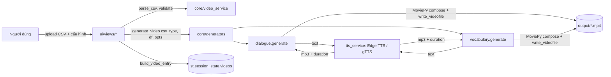

# Tài liệu hệ thống — Video Creation App (AS-IS)

> Phạm vi: mô tả logic & nghiệp vụ **hiện tại** của mã nguồn, dựa trên việc đọc toàn bộ source code ngày 2026-11-08.
> Mọi nhận định đều dẫn chiếu `file:line`. Phần "Vấn đề đã phát hiện" là quan sát từ code, chưa được kiểm chứng bằng chạy thử.

---

## 1. Tổng quan

Ứng dụng **Streamlit** chạy local, tạo video học tiếng Anh từ file CSV:

| Loại video | Đầu vào | Đầu ra |
|---|---|---|
| **Hội thoại 2 người** (`dialogue`) | CSV `speaker 1;speaker 2` | MP4: mỗi lượt thoại = 1 scene, chữ + giọng đọc TTS |
| **Từ vựng / Flashcard** (`vocabulary`) | CSV `english;ipa;vietnam;example;translate[;image]` | MP4: mỗi từ = 1 thẻ, chữ + TTS EN (tuỳ chọn TTS VI) |

Công nghệ: Python 3.10+, Streamlit (UI), pandas (CSV), MoviePy **2.x API** (dựng video), Pillow (vẽ bubble/đo chữ), edge-tts & gTTS (giọng đọc), FFmpeg (encode).

Video mẫu đã tạo trong `output/`: *10 Common Fruit Names in English*, *10 Common Vegetable Names in English* (từ vựng), *Express Laundry is HOW MUCH* (hội thoại).

---

## 2. Kiến trúc & cấu trúc thư mục

```
app.py                 Entry point: page config → inject CSS → init state → sidebar → route
config.py              Cấu hình trung tâm: thư mục, fonts (auto-discover), độ phân giải,
                       danh sách giọng Edge TTS (13 EN, 2 VI), định nghĩa loại CSV
core/                  "Backend" — không phụ thuộc Streamlit (trừ state.py)
  state.py             Bọc st.session_state: danh sách video + thống kê
  tts_service.py       synthesize() (gTTS), synthesize_edge() (Edge TTS), get_audio_duration()
  video_service.py     parse/detect CSV, csv_to_text, build_video_entry, filter/sort, thống kê 7 ngày
  generators/
    __init__.py        Registry csv_type → generator; generate_video() dispatch
    dialogue.py        Dựng video hội thoại
    vocabulary.py      Dựng video flashcard
ui/
  router.py            Danh sách route (thứ tự = thứ tự sidebar)
  styles.py            CSS toàn cục
  components/          sidebar, page_header, video_card, csv_preview
  views/               dashboard, dialogue_video, vocabulary_video, create_video, manage_videos
assets/fonts/          3 font .ttf (Arial Unicode, Arial Rounded Bold, Bungee Outline)
data/                  (trống — chưa dùng)
output/                Video xuất ra
pages/                 Chỉ còn __pycache__ — tàn dư của cấu trúc multipage cũ
```

Phân lớp: `ui/views` (thu thập tham số) → `core/generators.generate_video()` (dispatch) → generator cụ thể → `tts_service` + MoviePy → file trong `output/`. Kết quả được ghi lại thành một "video record" trong `st.session_state`.



---

## 3. Màn hình & luồng nghiệp vụ

Sidebar (`ui/router.py:44-50`): Dashboard → Video Hội Thoại → Video Từ Vựng → Tạo Video → Quản lý Video.

### 3.1 Dashboard (`ui/views/dashboard.py`)
- 4 metric: tổng / hoàn thành / đang xử lý / lỗi (`core/state.py:59-66`).
- "Thao tác nhanh": các nút set `create_mode` rồi rerun — **không có tác dụng điều hướng** (không view nào đọc `create_mode`).
- Bảng 5 video gần nhất; biểu đồ số video 7 ngày. Khi chưa có video, biểu đồ hiển thị **số ngẫu nhiên** (`dashboard.py:73`).

### 3.2 Video Hội Thoại (`ui/views/dialogue_video.py`) — luồng chính cho dialogue
1. **Upload CSV** → `parse_csv(sep=";")`; nếu ra ≤1 cột thì tự dò separator (`video_service.py:32-50`). Tên cột được lower/strip. Kiểm tra cột bắt buộc `speaker 1`, `speaker 2`. Preview dạng chat.
2. **Giọng đọc từng speaker**: chọn trong 13 giọng Edge TTS en-US (`config.py:48-116`).
3. **Cài đặt video**: độ phân giải 16:9 / 9:16 (mặc định 9:16), FPS 15–60, định dạng MP4/AVI/MOV/WEBM, tên file.
4. **Hình nền**: màu đơn sắc, upload nhiều ảnh, hoặc chọn từ `assets/` (ảnh được **xoay vòng theo scene**).
5. **Hiển thị**: bật/tắt bubble chat, cỡ chữ (mặc định 55), màu chữ, padding top (mặc định 50%), font.
6. **Live preview** bằng HTML/CSS (mô phỏng, không phải frame thật).
7. **Tạo video** → `generate_video("dialogue", ...)`; thanh tiến trình theo số dòng CSV; thành công → nút tải + ghi record "Hoàn thành"; lỗi → record "Lỗi".

### 3.3 Video Từ Vựng (`ui/views/vocabulary_video.py`)
1. Upload CSV, kiểm tra 5 cột bắt buộc; cột `image` tuỳ chọn.
2. Nếu có cột `image`: upload ảnh minh hoạ, đối chiếu tên file (khớp/thiếu), lưu vào temp dir và cache trong session để sống qua rerun (`:96-166`).
3. Giọng EN (13 giọng), số lần lặp từ (1–5), bật/tắt TTS tiếng Việt (2 giọng vi-VN).
4. Video settings, hình nền, hiển thị (cỡ chữ từ/ví dụ, top padding, font EN/VI riêng), preview HTML.
5. Tạo video → `generate_video("vocabulary", ...)`.

### 3.4 Tạo Video — trang chung (`ui/views/create_video.py`)
- 3 cách nhập: text trực tiếp, file .txt, file .csv (chọn loại / auto-detect).
- **Text/.txt chỉ là demo**: không tạo video, nhưng vẫn ghi record "Hoàn thành" (`:485-507`).
- CSV: gọi cùng generator nhưng **không truyền** voice, bubble, font… → dùng giá trị mặc định của generator (gTTS cho dialogue).
- Các lựa chọn "Tốc độ đọc", "Engine TTS", "Kiểu chữ trên video" chỉ được lưu vào record, **không ảnh hưởng video**.

### 3.5 Quản lý Video (`ui/views/manage_videos.py`)
- Tìm theo tên, lọc trạng thái/độ phân giải, sắp xếp, dạng thẻ hoặc bảng, xem chi tiết, xoá, xoá hàng loạt video lỗi, xuất danh sách CSV.
- Xoá chỉ xoá record trong session, **không xoá file** trong `output/`.

---

## 4. Logic dựng video (core)

### 4.1 Hội thoại — `core/generators/dialogue.py`
- Duyệt từng dòng CSV: nếu `speaker 1` có nội dung → 1 scene; nếu `speaker 2` có nội dung → 1 scene (thứ tự luôn S1 rồi S2 trong cùng dòng). Ô trống / `nan` bị bỏ qua (`:403-431`).
- **Mỗi scene** (`_build_scene`, `:119-168`):
  - TTS: nếu voice có `engine == "edge"` → Edge TTS với `voice_id`; ngược lại → gTTS theo `lang`.
  - Thời lượng scene = thời lượng audio + **0.5s** đệm.
  - Nền: ảnh (resize đúng khung) hoặc `ColorClip`.
  - **Plain mode** (`:171-221`): text trái (S1) / phải (S2), rộng 80% khung, thanh màu 6px ở đỉnh theo màu speaker (S1 `#667eea`, S2 `#764ba2`).
  - **Bubble mode** (`:224-330`): bubble bo góc (radius 30, padding 40×30, alpha 220), rộng tối đa 70% khung, S1 bên trái / S2 bên phải, thêm "đuôi" 3 vòng tròn (30/20/12 px × scale) phía trên bubble.
  - Chữ được tự xuống dòng bằng Pillow (`_wrap_text`, `:80-113`) để tránh lỗi MoviePy cắt giữa từ.
- Ghép tất cả scene (`concatenate_videoclips`), encode `libx264` + `aac` → `output/{name}.{fmt}`.
- Mỗi thời điểm chỉ hiển thị **1 câu thoại**; không có tên nhân vật, không có bản dịch tiếng Việt.

### 4.2 Từ vựng — `core/generators/vocabulary.py`
- Mỗi từ = 1 scene (`_make_word_scene`, `:44-237`). Trình tự audio:
  `word EN × repeat` (cách 0.4s, sau lần cuối 0.8s) → `[nghĩa VI + 0.8s]` → `example EN + 0.8s` → `[translate VI + 0.8s]`.
- Bố cục từ trên xuống, bắt đầu ở `top_padding_pct`: từ (màu `#667eea`) → `/IPA/` → nghĩa VI → ảnh minh hoạ (≤50% rộng, ≤25% cao) → vạch ngăn → câu ví dụ → bản dịch.
- Toàn bộ chữ hiện ngay từ đầu scene (không có hiệu ứng xuất hiện theo audio).
- Tham số `lang` bị bỏ qua: luôn dùng `lang_word="en"` (`:340`).

### 4.3 TTS — `core/tts_service.py`
- `synthesize()` — gTTS (Google Translate TTS, không chính thức), hỗ trợ `lang`, `tld`, `slow`.
- `synthesize_edge()` — edge-tts (endpoint Read Aloud của Microsoft Edge, không chính thức). Xử lý trường hợp event loop đang chạy bằng ThreadPoolExecutor.
- Mỗi câu = 1 request mạng, chạy **tuần tự**, không cache, không retry.
- Cả hai engine đều **gửi văn bản ra dịch vụ bên ngoài** (Google / Microsoft).

### 4.4 Lưu trữ — `core/state.py`
- Lịch sử video chỉ nằm trong `st.session_state` → **mất khi reload trang / restart app**. Thư mục `data/` chưa được dùng.
- Trạng thái: `Hoàn thành`, `Lỗi`, `Đang xử lý` (trạng thái cuối không bao giờ được set vì tạo video là đồng bộ).

---

## 5. Mô hình dữ liệu

**CSV hội thoại** (separator `;`):
```csv
speaker 1;speaker 2
I couldn't sleep well last night.;The bedroom was definitely too hot.
```

**CSV từ vựng**:
```csv
english;ipa;vietnam;example;translate;image
abandon;əˈbændən;từ bỏ;She had to abandon her car.;Cô ấy phải bỏ lại xe.;abandon.png
```

**Video record** (`video_service.build_video_entry`, `:87-119`): `name, resolution, fps, format, text_style, text_content, tts_lang, tts_speed, tts_engine, bg_mode, content_type, csv_type, status, created_at, output_path`.

---

## 6. Vấn đề đã phát hiện (từ đọc code)

| # | Mức | Vấn đề | Vị trí |
|---|---|---|---|
| 1 | Cao | `requirements.txt` ghi `moviepy>=1.0.3` nhưng code dùng API MoviePy 2.x (`from moviepy import …`, `.with_duration`, `.resized`) → cài môi trường mới có thể nhận bản 1.x và lỗi import. `numpy` dùng trực tiếp nhưng không khai báo. | `requirements.txt:5`, `dialogue.py:14-23` |
| 2 | Cao | Tên video từ người dùng ghép thẳng vào đường dẫn file, không làm sạch → có thể ghi đè file trùng tên hoặc ghi ra ngoài `output/` (ví dụ tên chứa `../`). | `dialogue.py:440`, `vocabulary.py:366`, `video_service.py:118` |
| 3 | Cao | Lịch sử video chỉ lưu trong session → mất khi reload. | `core/state.py` |
| 4 | Trung bình | Trang "Tạo Video" với CSV hội thoại: không truyền voice → dùng gTTS với ngôn ngữ đang chọn, mặc định là **Tiếng Việt** → câu tiếng Anh bị đọc bằng giọng Việt. | `create_video.py:241`, `dialogue.py:147-150` |
| 5 | Trung bình | Chế độ text/.txt giả lập: ghi record "Hoàn thành" dù không có file video. | `create_video.py:485-507` |
| 6 | Trung bình | Mặc định 2 speaker cùng 1 giọng (`index=0` cho cả hai). | `dialogue_video.py:99,108` |
| 7 | Trung bình | IPA bị bọc thêm `/…/`; nếu CSV đã có dấu `/` (như mẫu trong README) sẽ thành `//əˈbændən//`. | `vocabulary.py:147`, `README.md:101` |
| 8 | Trung bình | Edge TTS & gTTS là endpoint không chính thức: không có SLA, có thể bị chặn/đổi; điều khoản sử dụng cho mục đích thương mại cần xác nhận. | `tts_service.py` |
| 9 | Trung bình | Font `Arial Unicode`, `Arial Rounded Bold` là font có bản quyền (Monotype/Apple) — cần xác nhận giấy phép trước khi dùng thương mại/đóng gói. `Bungee Outline` là OFL. | `assets/fonts/` |
| 10 | Thấp | Tốc độ đọc, engine TTS, kiểu chữ ở trang "Tạo Video" không được dùng. | `create_video.py:236-297` |
| 11 | Thấp | Biểu đồ dashboard hiển thị số ngẫu nhiên khi chưa có dữ liệu; nút thao tác nhanh không điều hướng. | `dashboard.py:30-39,73` |
| 12 | Thấp | Bộ lọc độ phân giải có `1080p/720p/480p` không khớp nhãn thật. | `manage_videos.py:24` |
| 13 | Thấp | Xoá video không xoá file; temp dir (mp3, ảnh) không bao giờ dọn. | `state.py:40`, `dialogue.py:382` |
| 14 | Thấp | Nút tải luôn dùng `mime="video/mp4"` cho mọi định dạng. | `dialogue_video.py:482`, `vocabulary_video.py:567` |
| 15 | Thấp | Nội dung CSV được chèn vào HTML với `unsafe_allow_html=True` (HTML injection; rủi ro thấp vì app chạy local một người dùng). | `csv_preview.py:99-165` |
| 16 | Thấp | `print()` debug còn sót trong generator từ vựng. | `vocabulary.py:305-336` |
| 17 | Quy trình | Không có git repo, không có test tự động, không có logging. | — |
| 18 | Hiệu năng | Tạo video chạy đồng bộ trong request Streamlit; TTS tuần tự; mỗi scene dựng nhiều `TextClip` → chậm với video dài, và đóng tab là mất tiến trình. | `generators/*` |

---

## 7. Điểm mạnh nên giữ lại

- Phân tách `core/` (không phụ thuộc UI) và `ui/` rõ ràng → có thể tái sử dụng core cho pipeline CLI/worker.
- Registry generator (`core/generators/__init__.py`) dễ mở rộng thêm loại video mới.
- Tự wrap chữ bằng Pillow, bubble/tail tự vẽ → đã có nền tảng để render frame bằng Pillow.
- Hỗ trợ sẵn giọng vi-VN và font riêng cho tiếng Việt.
