# Đề xuất nâng cấp — Pipeline tự động tạo video bài học hội thoại song ngữ

> Trạng thái: **Bản đề xuất (draft) — cần review của con người** trước khi triển khai (thay đổi kiến trúc, chọn nhà cung cấp AI/TTS, chi phí).
> Tài liệu nền: [01-system-documentation.md](01-system-documentation.md).

---

## 1. Yêu cầu, giả định và câu hỏi mở

### 1.1 Yêu cầu (theo yêu cầu đã nêu)
- **R1** — Tự động tạo **script hội thoại chất lượng**.
- **R2** — Script **song ngữ Anh–Việt** (mỗi câu thoại có bản dịch tiếng Việt).
- **R3** — Phần **tổng hợp 10 từ vựng** liên quan, xuất hiện trong hội thoại, cần ghi nhớ.
- **R4** — Phần **bài tập** để người xem tự nhớ lại và trả lời.
- **R5** — **Pipeline tự động** từ đầu vào (chủ đề) đến video hoàn chỉnh.

### 1.2 Giả định của đề xuất (cần xác nhận)
- **A1** — Người xem là người Việt học tiếng Anh, trình độ A2–B1 (CEFR), có thể cấu hình theo từng video.
- **A2** — Định dạng chính 9:16 (Shorts/Reels/TikTok), có hỗ trợ 16:9. Độ dài mục tiêu khoảng 3–5 phút/video (ước lượng ở §4.3) — **cần đối chiếu giới hạn độ dài của từng nền tảng**.
- **A3** — Audio chính là tiếng Anh; tiếng Việt chủ yếu là phụ đề, giọng đọc tiếng Việt là tuỳ chọn.
- **A4** — Nội dung là bài học chung, **không chứa dữ liệu cá nhân hay dữ liệu khách hàng**; việc gửi chủ đề/script sang dịch vụ LLM và TTS bên ngoài cần được người phụ trách phê duyệt.
- **A5** — Quy mô ban đầu: vài chục video/tuần, chạy trên một máy (local hoặc 1 VM).

### 1.3 Câu hỏi mở (ảnh hưởng thiết kế)
1. Trình độ mục tiêu và độ dài video mong muốn?
2. Kênh phát hành (YouTube, TikTok…)? Có cần tự động đăng hay chỉ xuất file?
3. Có được dùng LLM API bên ngoài (Claude) không? Ngân sách/tháng?
4. TTS: tiếp tục dùng edge-tts (không chính thức) hay chuyển sang dịch vụ có hợp đồng (Azure AI Speech, ElevenLabs…) để dùng thương mại?
5. Ai là người duyệt nội dung trước khi xuất bản?

---

## 2. Tổng quan giải pháp

Chuyển từ mô hình **"người dùng chuẩn bị CSV → app dựng video"** sang **"chủ đề → bài học có cấu trúc (Lesson JSON) → kiểm tra → duyệt → dựng video"**.

Ý tưởng chính: **Lesson JSON là nguồn dữ liệu duy nhất (single source of truth)**. LLM chỉ làm một việc là sinh nội dung theo schema cố định. Mọi bước sau (kiểm tra, TTS, dựng hình, phụ đề, metadata) là **code tất định**, kiểm thử được và chạy lại được. Không cần "AI agent", vector DB hay microservice cho bài toán này.

```mermaid
flowchart LR
  B[Brief: chủ đề, level, persona] --> G[1. Sinh Lesson JSON<br/>LLM + structured output]
  G --> V[2. Kiểm tra tự động<br/>rule tất định]
  V -- lỗi --> G
  V -- đạt --> H[3. Duyệt bởi người<br/>Streamlit Review]
  H -- sửa/duyệt --> T[4. TTS + cache]
  T --> R[5. Dựng các phân đoạn<br/>Intro · Dialogue · Vocab · Exercise · Outro]
  R --> A[6. Ghép + xuất<br/>MP4, SRT EN/VI, thumbnail, metadata]
  A --> Q[7. QA tự động]
  Q --> P[8. Phát hành - tuỳ chọn, cần duyệt]
```



---

## 3. Thiết kế nội dung bài học

### 3.1 Lesson JSON (schema đề xuất)

```jsonc
{
  "lesson_id": "2026-11-08-laundry-a2",
  "schema_version": 1,
  "meta": {
    "topic": "At the laundromat",
    "level": "A2",
    "title_en": "Express Laundry is HOW MUCH?",
    "title_vi": "Giặt nhanh mà giá BAO NHIÊU?",
    "learning_goal_vi": "Hỏi giá và dịch vụ ở tiệm giặt"
  },
  "characters": [
    { "id": "A", "name": "Mia",  "gender": "female", "voice": "en-US-AvaNeural" },
    { "id": "B", "name": "Tom",  "gender": "male",   "voice": "en-US-AndrewNeural" }
  ],
  "dialogue": [
    {
      "idx": 0,
      "speaker": "A",
      "en": "Hi, how much is the express service?",
      "vi": "Chào anh, dịch vụ giặt nhanh giá bao nhiêu ạ?",
      "vocab_refs": ["express"]
    }
    // 8–14 lượt, xen kẽ A/B
  ],
  "vocabulary": [
    {
      "word": "express",
      "lemma": "express",
      "pos": "adjective",
      "ipa": "ɪkˈsprɛs",            // không kèm dấu "/"
      "meaning_vi": "nhanh, hoả tốc",
      "example_en": "Hi, how much is the express service?",  // lấy từ hội thoại
      "example_vi": "Chào anh, dịch vụ giặt nhanh giá bao nhiêu ạ?",
      "dialogue_idx": 0,
      "image_prompt": null
    }
    // đúng 10 mục
  ],
  "exercises": [
    {
      "id": "ex1",
      "type": "multiple_choice",     // multiple_choice | fill_blank | translate_vi_en | comprehension
      "prompt_en": "What does \"express\" mean?",
      "prompt_vi": "\"express\" nghĩa là gì?",
      "options": ["chậm", "nhanh, hoả tốc", "rẻ"],
      "answer": "nhanh, hoả tốc",
      "explanation_vi": "express service = dịch vụ làm nhanh",
      "think_seconds": 5,
      "vocab_refs": ["express"]
    }
    // 5 bài (cấu hình được)
  ]
}
```

Ghi chú:
- Có thể **nhập Lesson JSON thủ công** (hoặc từ CSV mở rộng) → hệ thống vẫn chạy được khi không có LLM. Đây là phần nên làm trước (§6, Giai đoạn 1).
- Định dạng CSV cũ được giữ lại để tương thích ngược.

### 3.2 Tạo script hội thoại có chất lượng (R1, R2)

**Đầu vào (brief)**: chủ đề, level, bối cảnh, 2 nhân vật, số lượt thoại, tuỳ chọn danh sách từ bắt buộc phải có, các chủ đề đã làm gần đây (để tránh trùng).

**Nguyên tắc cho prompt** (đặt trong system prompt cố định để tận dụng prompt caching):
- Tiếng Anh tự nhiên kiểu văn nói: có dạng rút gọn (I'm, don't), phản hồi ngắn, có cảm xúc, có một tình huống/twist nhỏ để giữ chân người xem.
- Câu ngắn, phù hợp level (ví dụ A2: phần lớn câu ≤ 12 từ) — giới hạn này được **kiểm tra lại bằng code**, không chỉ dựa vào prompt.
- Bản dịch tiếng Việt **dịch theo nghĩa, tự nhiên**, giữ đúng sắc thái và xưng hô (anh/chị/em…), không dịch word-by-word.
- 10 từ vựng phải **xuất hiện tự nhiên** trong hội thoại, ưu tiên từ/cụm từ có ích (collocation, phrasal verb) thay vì từ quá dễ.
- Không dùng tên thương hiệu thật hay người thật; nội dung phù hợp mọi lứa tuổi.
- Kèm 1–2 ví dụ Lesson mẫu đã được duyệt (few-shot) trong phần prompt được cache.

**Gọi LLM** (đề xuất: Claude API, Python SDK `anthropic`):
- Model mặc định `claude-opus-5-5`, **đặt effort rõ ràng** (`output_config.effort`; model này mặc định `medium`). Có thể thử nghiệm model rẻ hơn (Sonnet/Haiku 5.5) **sau khi** có bộ đánh giá (§3.6) — đây là quyết định chi phí của người phụ trách.
- **Structured outputs** (`output_config.format` với JSON Schema, hoặc `client.messages.parse()` + Pydantic) để đảm bảo đầu ra đúng schema. Chi tiết chữ ký hàm cần đối chiếu tài liệu SDK khi triển khai.
- **Prompt caching** cho phần system prompt, style guide và ví dụ mẫu (không đặt timestamp/ID vào phần được cache).
- **Message Batches API** cho các đợt tạo hàng loạt chạy đêm (bất đồng bộ, rẻ hơn khoảng 50%).
- Luôn kiểm tra `stop_reason` (`max_tokens`, `refusal`) trước khi đọc kết quả.
- Không gửi dữ liệu cá nhân hay dữ liệu khách hàng trong prompt (A4).

### 3.3 Tổng hợp 10 từ vựng (R3)
- LLM đề xuất, sau đó **code kiểm tra**: đúng 10 mục, không trùng, mỗi từ/lemma có trong đúng câu thoại `dialogue_idx`, `example_en` trùng với câu thoại đó.
- **IPA** là điểm LLM dễ sai → kiểm tra định dạng bằng code, đối chiếu từ điển phát âm nếu có (ví dụ CMUdict chuyển sang IPA cho từ đơn), các từ không đối chiếu được sẽ **được đánh dấu để người duyệt kiểm tra**.
- Trên video: tái sử dụng generator flashcard hiện có (`core/generators/vocabulary.py`) nhưng đọc dữ liệu từ Lesson; thêm hiển thị câu thoại gốc để người xem nhớ ngữ cảnh.

### 3.4 Bài tập tự nhớ (R4) — dựa trên nguyên lý *active recall*
Mỗi bài tập gồm 3 nhịp: **Hỏi → Đếm ngược "Pause & answer" (3–7s) → Đáp án + audio + giải thích ngắn**.

| Loại | Ví dụ | Mục tiêu |
|---|---|---|
| `multiple_choice` | "express" nghĩa là gì? A/B/C | Nhận diện nghĩa |
| `fill_blank` | "How much is the ____ service?" | Nhớ từ trong ngữ cảnh |
| `translate_vi_en` | Hiện câu Việt → người xem tự nói câu Anh | Chủ động nói (khó nhất) |
| `comprehension` | "Why was Tom surprised?" | Hiểu hội thoại |

Quy tắc kiểm tra: đáp án nằm trong `options`; các lựa chọn khác nhau; câu hỏi không lộ đáp án; mỗi bài tập phải liên kết tới ít nhất 1 từ vựng; độ khó tăng dần.

### 3.5 Kiểm tra tự động (deterministic validators)
- Schema hợp lệ; 8–14 lượt thoại; 2 nhân vật xen kẽ; mỗi lượt có `en` và `vi` (tiếng Việt có dấu).
- Giới hạn độ dài câu theo level; **câu vừa khung hình**: dùng `_wrap_text` hiện có để đo số dòng ở cỡ chữ và độ phân giải đã chọn.
- Các ràng buộc từ vựng và bài tập ở §3.3–3.4.
- Danh sách từ cấm / tên thương hiệu.
- Nếu không đạt: gửi **danh sách lỗi cụ thể** lại cho LLM để sửa (tối đa 2 lần), sau đó chuyển cho người xử lý.

### 3.6 Đánh giá chất lượng (trước khi đổi prompt/model)
- Bộ 20–30 brief cố định, gồm nhiều chủ đề và level.
- Chỉ số: tỷ lệ qua validator ngay lần đầu, tỷ lệ người duyệt chấp nhận, số chỗ người duyệt phải sửa, điểm rubric (tự nhiên / đúng level / dịch tự nhiên / từ vựng hữu ích / bài tập hợp lý).
- Tuỳ chọn: dùng LLM chấm theo rubric để lọc sơ bộ; **không thay thế** người duyệt.

---

## 4. Thiết kế video

### 4.1 Cấu trúc (storyboard)

| Phân đoạn | Nội dung | Audio |
|---|---|---|
| 0. Hook / Intro (3–5s) | Tiêu đề EN + VI, câu "Hôm nay học: …" | Nhạc nền nhẹ (tuỳ chọn) |
| 1. Hội thoại | Bubble chat có **tên + avatar**, câu EN (lớn) + **VI (nhỏ, bên dưới)**; **tô màu từ vựng** trong câu; giữ lại 2–3 bubble trước đó để giống khung chat | EN theo giọng từng nhân vật |
| 2. Từ vựng (10 thẻ) | Từ · IPA · loại từ · nghĩa VI · câu thoại gốc | EN (lặp N lần) + tuỳ chọn VI |
| 3. Bài tập | Câu hỏi → đồng hồ đếm ngược → đáp án | EN/VI |
| 4. Recap & CTA | Lưới 10 từ, "Lưu video để ôn lại" | — |

Tuỳ chọn: phát lại hội thoại lần 2 (chỉ tiếng Anh, ẩn tiếng Việt) để luyện nghe.

### 4.2 Thay đổi kỹ thuật dựng hình
- **Render từng scene thành ảnh bằng Pillow** (đã dùng sẵn cho bubble), rồi đưa vào `ImageClip`, thay vì dùng nhiều `TextClip` của MoviePy. Lợi ích: hỗ trợ chữ nhiều màu (highlight từ vựng), kiểm soát font tiếng Việt, nhanh hơn, dễ test bằng snapshot.
- Mỗi phân đoạn là một **renderer** riêng (`render_dialogue`, `render_vocab`, `render_exercise`…) nhận dữ liệu Lesson và trả về clip; thêm vào registry hiện có.
- Xuất thêm: **SRT tiếng Anh và tiếng Việt** (từ timeline audio), thumbnail (PNG), `metadata.json` (tiêu đề, mô tả, hashtag, danh sách từ).

### 4.3 Ước lượng thời lượng (giả định, cần đo thực tế)
Hội thoại 10–12 lượt × ~4s ≈ 45–60s · Từ vựng 10 × ~8–10s ≈ 80–100s · Bài tập 5 × ~10–12s ≈ 50–60s · Intro/Recap ≈ 10–15s → **khoảng 3–4 phút**. Nếu cần video ngắn hơn: cấu hình `vocab_count`, `exercise_count`, `repeat_en`.

---

## 5. Kiến trúc pipeline tự động (R5)

### 5.1 Nguyên tắc
- **Đơn giản**: 1 tiến trình worker + SQLite + hệ thống file. Không cần Kubernetes, message broker hay microservice ở quy mô A5. Chỉ chuyển sang hàng đợi (RQ/Celery + Redis) khi có nhu cầu chạy song song trên nhiều máy.
- **Mỗi bước có trạng thái, idempotent, chạy tiếp được**: mỗi bước ghi artifact vào `output/lessons/<lesson_id>/`. Khi chạy lại, các bước đã hoàn thành (có hash đầu vào khớp) sẽ được bỏ qua.
- **Core không phụ thuộc Streamlit**: Streamlit chỉ là giao diện duyệt và theo dõi; pipeline chạy được bằng CLI.

### 5.2 Cấu trúc mã đề xuất

```
core/
  lesson/
    schema.py          Pydantic models: Lesson, DialogueTurn, VocabItem, Exercise
    validators.py      Rule kiểm tra tất định (§3.5)
    importers.py       Lesson từ JSON / CSV (tương thích CSV cũ)
  content/
    llm_client.py      Gọi Claude API (structured output, cache, batch, retry)
    prompts/           system prompt, style guide, ví dụ mẫu (có version)
    generator.py       brief → Lesson (kèm vòng sửa lỗi)
  tts/
    service.py         Interface TTS + backend (edge, azure, …) + cache theo hash(text+voice)
  render/
    frames.py          Vẽ frame bằng Pillow (bubble, highlight, card, countdown)
    segments/          intro.py, dialogue.py, vocab.py, exercise.py, outro.py
    subtitles.py       Xuất SRT EN/VI
    assemble.py        Ghép phân đoạn, encode
  pipeline/
    stages.py          generate → validate → review_gate → tts → render → assemble → qa
    runner.py          Chạy 1 lesson, cập nhật trạng thái, resume
    worker.py          Lấy job từ SQLite và chạy
    cli.py             python -m core.pipeline.cli run|batch|status|retry
  storage/
    db.py              SQLite: lessons, jobs, stage_runs, videos (thay session_state)
ui/views/
  lesson_review.py     Xem/sửa Lesson JSON, xem trước, Duyệt / Từ chối
  pipeline_monitor.py  Hàng đợi, trạng thái từng bước, log, chạy lại
```

### 5.3 Trạng thái job

```
DRAFT → GENERATED → VALIDATED → (AWAITING_REVIEW) → APPROVED → AUDIO_READY → RENDERED → DONE
                       ↘ FAILED_VALIDATION        ↘ REJECTED            ↘ FAILED (kèm stage + lỗi)
```
- `review_gate` là tuỳ chọn cấu hình, nhưng **mặc định bật**: không xuất bản nội dung do AI tạo khi chưa có người duyệt.

### 5.4 Cách vận hành
- **Một video**: Streamlit → "Tạo bài học" → nhập brief → theo dõi → duyệt → tải video.
- **Hàng loạt**: `briefs/2026-W46.yaml` (danh sách chủ đề) → `python -m core.pipeline.cli batch briefs/2026-W46.yaml` → sinh nội dung qua Batch API → các lesson nằm ở trạng thái `AWAITING_REVIEW` → người duyệt hàng loạt → worker dựng video.
- **Lịch chạy**: cron/launchd chạy worker hoặc batch theo lịch. Nếu cần CI thì dùng GitHub Actions hoặc Azure Pipelines (có cache font và ffmpeg).
- **Quan sát**: log có cấu trúc theo `lesson_id/stage`; lưu token usage, chi phí ước tính, thời gian từng bước vào SQLite; dashboard hiển thị số liệu thật thay cho dữ liệu ngẫu nhiên.

### 5.5 Bảo mật & tuân thủ
- API key lấy từ biến môi trường / secret store, **không commit** vào repo; thêm `.gitignore` cho `.env`, `output/`, `data/*.db`.
- Làm sạch tên file (slug) và giới hạn đường dẫn trong `output/`.
- Escape nội dung trước khi đưa vào HTML ở UI.
- Xác nhận điều khoản sử dụng của edge-tts/gTTS và giấy phép font trước khi dùng thương mại.

---

## 6. Lộ trình triển khai (đề xuất theo giai đoạn)

Ước lượng chỉ là kích thước tương đối (S/M/L) để thảo luận, **không phải cam kết** — cần TECHVIFY/PM xác nhận sau khi chốt các câu hỏi ở §1.3.

| Giai đoạn | Nội dung | Kích thước | Tiêu chí nghiệm thu |
|---|---|---|---|
| **0. Củng cố nền tảng** | Khởi tạo git; sửa các lỗi #1–#7, #13, #14, #16 trong tài liệu hệ thống; SQLite thay session_state; unit test cho `core/` | S | App cài được trên môi trường sạch; lịch sử video còn sau khi restart; test xanh |
| **1. Lesson model + video bài học** (chưa dùng AI) | Schema + validators + import JSON; render bằng Pillow; 5 phân đoạn; SRT EN/VI; trang Review | M | Từ 1 Lesson JSON viết tay tạo được video đủ 4 phần, phụ đề khớp audio (lệch ≤ 0.2s) |
| **2. Sinh nội dung bằng AI** | `llm_client` (structured output, caching), prompt có version, vòng sửa lỗi, bộ đánh giá 20–30 brief | M | ≥ 80% lesson qua validator ngay lần đầu; người duyệt chấp nhận ≥ 70% mà không cần sửa lớn (mục tiêu ban đầu, điều chỉnh theo thực tế) |
| **3. Pipeline tự động** | Stages + runner + worker + CLI + batch + TTS cache + trang Monitor + metadata/thumbnail | M | Chạy batch 10 chủ đề không cần can thiệp ngoài bước duyệt; chạy lại sau lỗi không làm lại các bước đã xong |
| **4. Phát hành (tuỳ chọn)** | Upload YouTube/TikTok qua API chính thức, chỉ sau khi duyệt | S–M | Video được đăng ở chế độ private/scheduled kèm metadata đúng |

---

## 7. Rủi ro & cách giảm thiểu

| Rủi ro | Ảnh hưởng | Giảm thiểu |
|---|---|---|
| LLM sai IPA, dịch chưa tự nhiên, từ quá dễ hoặc quá khó | Chất lượng giảm, mất uy tín | Validator + đối chiếu từ điển + bước duyệt bắt buộc + bộ đánh giá |
| edge-tts/gTTS bị chặn hoặc vi phạm điều khoản | Pipeline dừng, rủi ro pháp lý | Lớp TTS trừu tượng; chuẩn bị backend chính thức (Azure AI Speech có cùng giọng Neural) |
| Font có bản quyền | Rủi ro pháp lý khi dùng thương mại | Chuyển sang font OFL hỗ trợ tiếng Việt (ví dụ Be Vietnam Pro, Nunito, Inter) |
| Dựng video chậm | Throughput thấp | Render bằng Pillow, cache TTS, chạy TTS song song có giới hạn, worker riêng |
| Chi phí LLM tăng theo số lượng | Ngân sách | Prompt caching, Batch API, đo chi phí mỗi lesson, chọn model dựa trên số liệu đánh giá |
| Nội dung lặp lại giữa các video | Người xem chán | Lưu lịch sử chủ đề và từ vựng đã dùng trong SQLite, đưa vào brief để tránh trùng |

---

## 8. Bước tiếp theo đề xuất
1. Chốt các câu hỏi ở §1.3 (level, độ dài, kênh, LLM/TTS, người duyệt).
2. Duyệt schema Lesson (§3.1) và storyboard (§4.1) — có thể làm mockup 1 frame cho mỗi phân đoạn.
3. Triển khai **Giai đoạn 0 + 1** trước: mang lại giá trị ngay (video 4 phần từ JSON viết tay), và giảm rủi ro trước khi đưa AI vào.
